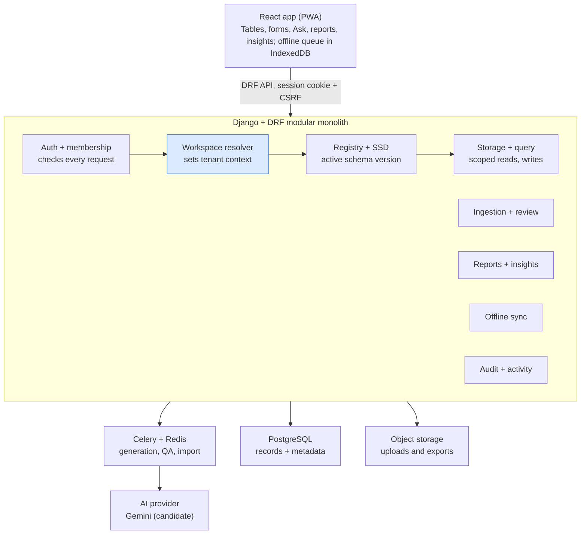

# Syntropy — Project Brief and Design Specification

> Repo copy of the Claude Doc (exported 24 Nov 2026). The Claude Doc in the Syntropy Project is the master; update both together when a decision changes.

Nov 24, 2026 · @Akande Solabomi

## 1. How to use this document

This is the single source of truth for building Syntropy. It combines the SRS v0.2 (6 November 2026) with the product and design decisions agreed on 24 November 2026, and it supersedes the SRS wherever the two differ.

- **For Claude in the Syntropy Project:** read this first in every new chat. Build what it says, respect the statuses below, and do not reverse a decision marked Agreed or Superseded without Sola saying so explicitly.
- **For Sola:** keep it in the Project files and in the repo at `docs/syntropy-spec.md`. Update it when a decision changes, instead of letting chats drift.

**Status labels** (from the SRS change-control rule):

| Label | Meaning |
| --- | --- |
| Agreed | Decided. Build to it. |
| Provisional | Current plan, but a test or benchmark can still change it. |
| Recommended | Proposed by Claude, not yet confirmed by Sola. |
| Deferred | Wanted, but not in the current phase. |
| Superseded | Was decided once, now replaced. Kept so it isn't accidentally revived. |
| Open | Not decided. Needs an answer before the work that depends on it. |

Implementation suggestions are not product requirements until marked Agreed.

## 2. Product overview

Syntropy is a multi-tenant SaaS web app that turns a small business's messy records into a working business database, then helps the owner run and understand the business from it.

**The problem.** Many Nigerian SMEs keep records in scattered spreadsheets, WhatsApp messages and paper notebooks. Totals are hard to trust, nobody knows who owes what, and answering "what sold best last month?" takes hours.

**What Syntropy does**

1. The owner uploads CSV/Excel files and describes the business in plain language. Handwritten ledger photos come in a later phase.
2. AI proposes a normalized structure (tables, fields, relationships) and maps the records into it. An independent QA pass checks the result, and deterministic code reconciles counts and totals.
3. The owner reviews anything uncertain, then activates the workspace.
4. The team works in familiar tables and forms (online or offline), asks questions in plain English, and gets reports, dashboards and insights.
5. Over time, AI suggests improvements to the structure. Nothing changes without the owner's approval.

**Target users.** Owners and staff of small and medium businesses with fragmented, unstructured or paper-based bookkeeping, starting in Nigeria (₦, day-first dates, intermittent connectivity).

**The name.** Syntropy is the tendency toward order, the opposite of entropy. The product takes a scattered pile of records and returns order.

**Core principle.** AI proposes, the business approves, and the backend validates and executes. AI never runs SQL, never invents business facts, and never changes structure on its own.

**What success looks like**

- A non-technical owner goes from upload to a working workspace without seeing SQL, JSON or database terms.
- Imported record counts and money totals match the source files, or every difference is shown.
- Staff record daily sales on a phone, including with no connection.
- The owner gets a useful answer to a plain-English question about their own business.
- No business ever sees another business's data.

## 3. History of the idea and superseded decisions

Syntropy has changed shape three times; the hosted SaaS is the current, agreed direction as of 24 November 2026.

| When | Stage | What it was |
| --- | --- | --- |
| Nov 2026 | Current | Hosted SaaS per the SRS, with the UX, Ask-in-MVP and offline-entry decisions in this document. Building starts in a dedicated Claude Project. |
| Oct–Nov 2026 | SRS v0.1–0.2 | Pivot to AI-adaptive multi-tenant workspaces: LLM-proposed schemas, JSONB storage, forms, queries, reports, approved adaptations. ZIP export explicitly excluded. |
| Sep 2026 | Schema converter | Chosen as Sola's second portfolio project over an algorithm evaluator. Upload CSV/Excel, infer schema with heuristics, generate Django models with Jinja2, download a ZIP. |
| Earlier | Hackathon concept | Original "Syntropy" idea: can informal Microsoft Access or spreadsheet setups become real production systems? Included a Canva mockup flow. |

**The original mockup flow** (still the spirit of the product): name the business → upload records → detect business type, entities and relationships with a confidence score → choose modules → preview a live dashboard → export or deploy.

**Superseded decisions.** Do not revive these without Sola's explicit say-so.

- **Downloadable ZIP** of generated Django models, Postgres schema, docker-compose, admin and fixtures → replaced by one shared SaaS app (ADR-01).
- **Heuristic, rule-based inference as the primary intelligence** → replaced by AI-powered generation (ADR-04). Deterministic code still does profiling, validation, reconciliation and query execution.
- **Jinja2 code generation** → no code is generated; the SSD drives a shared runtime.
- **Raw Access (.accdb/.mdb) parsing** → not planned. CSV and XLSX are the inputs; Access users export first.
- **Guided setup wizard as a later add-on** → absorbed into the onboarding flow (section 16).

**Kept from earlier stages:** the user always reviews uncertain AI output before it becomes fact; column names are sanitized into safe machine keys; spreadsheet cells are treated as untrusted (CSV/formula injection); money is never a float.

## 4. Decision register

ADR-01 to ADR-14 come from the SRS; ADR-15 onward were added on 24 November 2026.

| ID | Decision | Status |
| --- | --- | --- |
| ADR-01 | One shared Syntropy SaaS app with separate business workspaces; no generated Django apps or ZIP exports | Agreed |
| ADR-02 | React + TypeScript frontend; Django REST Framework backend | Agreed |
| ADR-03 | PostgreSQL primary database | Agreed |
| ADR-04 | AI-powered schema generation; no rule-based inference engine as primary intelligence | Agreed |
| ADR-05 | Independent generation QA, separate from recommendation/adaptation | Agreed |
| ADR-06 | AI-adaptive schemas: AI proposes, business approves, backend validates and executes | Agreed |
| ADR-07 | Versioned, storage-independent logical schema spec (SSD) and registry | Agreed direction |
| ADR-08 | JSONB business records plus native relational metadata and links for the first prototype | Agreed for the MVP (24 Nov 2026, after the Phase 2 benchmark; `docs/storage-decision.md`), with a database trigger that checks types and required fields against the published schema. Was Provisional |
| ADR-09 | Dynamic physical tables / schema-per-tenant kept as an alternative | Fallback behind the storage adapter; benchmarked faster but not adopted for the MVP; revisit at Phase 5 (`docs/storage-decision.md`). Was Under evaluation |
| ADR-10 | Modular Django monolith plus async workers; no premature microservices | Recommended baseline |
| ADR-11 | Gemini API as candidate provider; a consumer subscription does not cover API use | Candidate; verify pricing and terms |
| ADR-12 | Django ORM for platform entities; storage adapter for dynamic business records | Recommended baseline |
| ADR-13 | Forms, queries, reports and dashboards are core workspace capabilities | Agreed |
| ADR-14 | No interruptions during AI generation; review before activation when ambiguity or data risk warrants it | Agreed; review rule defined in ADR-17 |
| ADR-15 | Primary colour teal; violet reserved exclusively for AI-generated content | Agreed (teal "for now") |
| ADR-16 | Navigation labels: Home, Tables, Forms, Ask, Reports, Suggestions, Imports, Activity, Settings | Agreed; replaces SRS §8 names |
| ADR-17 | Review rule: "must decide" items block activation; low-risk choices auto-apply and are listed as undoable assumptions | Agreed; closes SRS open item "Review UX" |
| ADR-18 | Natural-language Ask (FR-14) is in the MVP | Agreed; was "Next" |
| ADR-19 | Offline data entry (create and edit records via forms, sync later) is in the MVP | Agreed |
| ADR-20 | Handwritten ledger capture stays after the MVP | Agreed (Later) |
| ADR-21 | UI written for business owners by default, with a per-user technical toggle | Agreed |
| ADR-22 | Visual style: clean, light and friendly; dark mode as tokens, shipped later | Agreed |
| ADR-23 | Insight numbers are computed deterministically by the backend; an LLM may only phrase them | Agreed |
| ADR-24 | Session-cookie auth with CSRF on a shared domain, not browser-stored JWTs | Recommended |
| ADR-25 | Money and decimals travel as strings in the API and are never JS floats | Agreed (follows SRS §7.3) |
| ADR-26 | OpenAPI schema (drf-spectacular) generates the frontend's TypeScript types | Recommended |
| ADR-27 | Offline sync uses client-generated record UUIDs, idempotency keys and optimistic concurrency | Recommended |

## 5. Users, roles and scope

Four roles exist per workspace; the MVP now includes Ask, offline entry and basic insight cards on top of the SRS MVP.

**Roles** (SRS §3.1). The permission matrix below is Recommended until confirmed; the SRS lists the full RBAC matrix as Open.

| Action | Owner | Admin | Editor (staff) | Viewer |
| --- | --- | --- | --- | --- |
| Billing, delete workspace | Yes | No | No | No |
| Approve schema changes and activate workspace | Yes | Activate only | No | No |
| Manage members and roles | Yes | Yes | No | No |
| Import data, edit structure labels | Yes | Yes | No | No |
| Create and edit records (online and offline) | Yes | Yes | Yes | No |
| Delete records | Yes | Yes | Own records only | No |
| Ask questions, run reports | Yes | Yes | Yes (permitted tables) | Yes (permitted tables) |
| Save reports and dashboards | Yes | Yes | Yes | No |
| Export CSV/PDF | Yes | Yes | No | No |

**In scope** (SRS §3.2): workspace setup, auth and RBAC; CSV, Excel and business descriptions as input; AI schema inference, normalization, relationships, mapping and population; independent QA; dynamic tables; schema-driven forms; filters and AI-assisted queries; reports, charts, dashboards and exports; AI recommendations with previews, approvals, version history and audit logs. Handwritten ledgers are a required capability, phased after the MVP.

**Excluded from the MVP** (SRS §3.3): exporting a separate Django app per business; unrestricted user SQL or LLM-executed SQL; autonomous destructive migrations; fine-tuning or a vector database as a dependency; full-scale handwriting ingestion.

**Functional requirements.** Priorities updated on 24 November 2026; changes are marked.

| ID | Requirement | Priority |
| --- | --- | --- |
| FR-01 | Create organization, workspace and membership with tenant-scoped authorization | MVP |
| FR-02 | Accept CSV/XLSX and natural-language business context; preserve originals and provenance | MVP |
| FR-03 | Profile source columns and samples; generate a logical schema through an LLM | MVP |
| FR-04 | Normalize entities; define fields, types, keys, cardinality and delete policies | MVP |
| FR-05 | Add only structurally necessary fields; never fabricate business facts | MVP |
| FR-06 | Independent QA of schema, mapping and data before activation | MVP |
| FR-07 | Track uncertain extraction/mapping and present review before committing ambiguous values | MVP |
| FR-08 | Populate records transactionally; reconcile source and import counts and totals | MVP |
| FR-09 | Show logical tables as familiar rows and columns regardless of storage | MVP |
| FR-10 | Generate create/edit forms with required, type, range, enum and relationship validation | MVP |
| FR-11 | Filters, search, sorting, pagination and structured read-only queries | MVP |
| FR-12 | At least one useful business-specific report and dashboard | MVP |
| FR-13 | Persist reusable report and query definitions with schema references | MVP (was Next; needed by Ask's "Save as report") |
| FR-14 | Translate natural-language questions to constrained query specs (Ask) | MVP (was Next) |
| FR-15 | Generate schema change proposals with plain-language impact summaries | Next |
| FR-16 | Explicit approval and backend validation before any schema change | Next |
| FR-17 | Safe additive changes first; version and audit all changes | Next |
| FR-18 | Digitize handwritten ledgers with image-capable models and reconciliation | Later |
| FR-19 | Export permitted tables/reports to CSV, reports to PDF | Next |
| FR-20 | Offline record entry: create and edit records via forms with no connection, then sync safely | MVP (new) |
| FR-21 | Insight cards from deterministic detectors (period change, debtors, low stock) | MVP (new) |
| FR-22 | Owner-language UI with a per-user technical toggle | MVP (new) |
| FR-23 | Data-quality panel: missing values, duplicates, orphaned links, flagged records | Next (new) |
| FR-24 | Custom dashboards with pinned charts | Next (new) |

## 6. System architecture and multi-tenancy

Syntropy is one modular Django monolith with async workers (ADR-10), and every business-data operation runs inside a server-verified workspace context.

**Every request passes the workspace resolver before touching data**

*System architecture · request path and supporting services. (Diagram redrawn in Mermaid from the Claude Doc for the repo copy.)*

Requests flow left to right through the top row; the resolver (highlighted) is the tenant-isolation checkpoint. Long work runs on Celery workers, which are the only path that sends data to the AI provider apart from Ask's schema-only calls.

**Request path** (SRS §7.6): authentication identifies the user → membership and permission checks for the requested workspace → the Tenant/Workspace Resolver sets a trusted workspace context → the Workspace Registry supplies the active schema version and storage location → the Storage or Query Engine performs a workspace-scoped operation. The client never chooses a workspace on trust.

**Workspace Registry.** Independent of storage, it maps each workspace to its active schema version, logical tables and storage configuration. The MVP uses one shared PostgreSQL database; the registry keeps an abstraction so selected workspaces can later move to their own schema or database without changing the API.

**Background jobs** carry and revalidate the workspace ID and permissions; they never trust client-supplied values. Generation, QA, imports, insight refreshes and large exports run as jobs; sync batches run inline when small and as jobs when large.

**Environments** (Recommended): local via Docker Compose (Django, Celery, PostgreSQL, Redis, MinIO for object storage, Vite dev server); hosting chosen in Phase 5.

## 7. AI generation, QA and adaptation

The LLM proposes structure and mappings as validated JSON; deterministic Python and PostgreSQL do everything that must be exact.

**Pipeline** (SRS §5.1), one Celery job per generation, retry-safe and idempotent:

1. Upload → private object storage (originals kept for provenance).
2. Deterministic parsing and profiling: sheets, header detection, row counts, per-column type candidates, null rates, distinct counts, sample values, money and date pattern detection, formula-like cells flagged.
3. LLM schema proposal: business description + column profiles + representative samples + allowed logical types → draft SSD + source mapping. Never SQL.
4. SSD validation (Pydantic): structure, types, references, naming, limits.
5. Independent QA: a separate context (optionally a different model) checks entities, cardinalities, fidelity and ambiguous assumptions.
6. Mapping and reconciliation: transform source values, compare counts and key totals with the source, and collect every uncertainty.
7. Review of material uncertainty by the owner (ADR-17, section 17).
8. Controlled transactional import.
9. Workspace activation; first reports and insights are created.
10. Later: suggestions and approved adaptations.

**AI contracts** (SRS §5.2)

- **Generation engine:** input is description, field profiles, samples and allowed types; output is a structured schema plus source mapping, as JSON matching a published schema. Uses the provider's structured-output mode.
- **QA engine:** independent review pass. It may reject, flag or annotate; it never silently fixes.
- **Adaptation engine:** emits constrained change operations (`add_table`, `add_nullable_field`, `add_relationship`, …) with rationale, evidence, impact and risk.
- **Ask engine (new, MVP):** turns a question plus the workspace's SSD (names and types, not record data) into a query AST. Returns a clarifying choice when ambiguous, and abstains when the data can't answer.
- **Insight phrasing (new, optional):** turns a computed finding (numbers already fixed) into one plain sentence. Output is checked to contain exactly the supplied numbers.
- **Abstention is allowed everywhere.** Low confidence or contradictory inputs never silently become facts.

**Messy real-world data the pipeline must handle** (recommended from the SRS review; currently under-specified):

- Ambiguous dates such as 03/04/2024; detect the column's convention, default day-first, flag when both readings are valid.
- Money written as "₦1,200", "1.2k", "N1200", "paid half"; parse what is certain, flag the rest.
- Entity resolution: "Mr Ade", "Ade O." and "Adebayo" may be one customer; propose merges, never merge silently.
- Denormalized sheets: one sales sheet holding customer, product and sale columns must be split into Customers, Products and Sales with links.
- Headers not on row 1, merged cells, totals rows inside data, blank spacer rows.

**Provider.** Gemini API is the candidate (ADR-11). Before building against it, verify API pricing, rate limits, data-handling terms and residency. Keep a provider interface so another model can be swapped in. Track tokens and cost per job against a per-workspace budget.

**Handwriting** (Later, SRS §5.3): keep source images, link extracted cells to image locations, flag illegible entries, reconcile totals, never invent values.

## 8. Syntropy Schema Definition (SSD)

The SSD is the canonical, versioned JSON description of a workspace's structure, validated server-side with Pydantic and independent of how records are physically stored.

**Required concepts** (SRS §6.1)

- `spec_version`, workspace ID, schema version number and publication status (draft, published, superseded).
- **Logical tables:** immutable ID, stable machine key (`sales`), editable display label ("Sales"), plus (new) a plain-language description and an icon name for the UI.
- **Fields:** immutable ID, machine key, display label, logical type, required/nullable, default, unique, range/length/precision, enum options, provenance metadata, plus (new) a display role (title field, money, quantity, status) used for labels, reports and insights.
- **Relationships:** immutable ID, source and target table and field, cardinality, optionality, delete policy (restrict by default), plus (new) a plain-language sentence ("Each sale belongs to one customer").
- **Logical types (initial):** `text`, `integer`, `decimal`, `boolean`, `date`, `datetime`, `enum`, `reference`. Money is `decimal` with a currency and a fixed scale.
- **Source mapping rules** linking uploaded files and columns to fields; original values and transformation records are retained.
- **Stable references:** forms, saved queries, reports and insight definitions point at field IDs, never display names.

**Versioning** (SRS §6.2)

- Published snapshots are immutable.
- AI produces drafts; the registry assigns immutable IDs and publishes validated versions.
- A change proposal names the base version it was built on; it is rejected if the base has moved.
- Approval triggers impact analysis, concurrency checks, execution, integrity verification and atomic publication where possible. Non-transactional steps need recovery procedures and state reconciliation.
- Forms, reports and saved queries are re-checked for compatibility on every new version; broken ones are flagged, never silently dropped.

**Naming rule** (carried over from the converter design): display labels can be anything the owner types; machine keys are generated as safe snake\_case identifiers, deduplicated, never reserved words, and never change after creation.

**First deliverable** (next sprint): SSD v1 as Pydantic models plus exported JSON Schema, with valid and invalid fixture tests, and a hand-written retail example (Customers, Products, Sales, with links).

## 9. Data storage, integrity and indexing

The first prototype stores business records as JSONB rows with relational link rows (ADR-08, agreed for the MVP after the Phase 2 benchmark), behind a storage adapter that can later switch to real per-tenant tables.

**JSONB-relational hybrid** (SRS §7.1). Platform metadata lives in ordinary tables. Each business record is one row in a shared `business_records` table: immutable record UUID, `workspace_id`, logical `table_id`, JSONB scalar values, version number and timestamps. Links live authoritatively in a relational `record_relationships` table. Never store a whole business database as one JSON document.

**Core entities** (SRS §7.2): organizations, memberships, workspaces, schema\_versions, logical\_tables, field\_definitions, relationship\_definitions, business\_records, record\_relationships, unique\_values (if the registry approach is chosen), source\_files, import\_jobs, import\_mappings, query\_definitions, report\_definitions, form\_definitions, schema\_change\_proposals, audit\_events. New for this design: insight\_definitions, dashboards, review\_items (uncertainties awaiting a decision), sync\_batches (offline uploads, with idempotency keys), notifications.

**Integrity requirements** (SRS §7.3)

- Native primary keys for platform entities and every record.
- Workspace-scoped foreign keys; a link must be impossible across workspaces or to the wrong logical table (FK to record UUID alone is insufficient).
- App validation plus database safeguards for required fields, types, ranges, enums and cardinality.
- Uniqueness enforced under concurrent writes (scoped indexes or a unique-value registry), never check-then-insert alone. Offline sync makes this critical.
- Restrict deletion of referenced records by default; cascade or set-null only when explicitly defined.
- Every multi-record operation is transactional; JSONB values and link rows can never diverge.
- Exact decimal arithmetic and a canonical decimal serialization; no binary floats for money.
- All writes go through authorized backend services.

**Selection gate** (SRS §7.5). Before production, benchmark JSONB against physical tables on: a 10,000-row import, joins, monthly aggregation, unique-constraint races, invalid foreign keys, delete policies, concurrent writes, schema changes and 100 simulated workspaces. Correctness is pass/fail; performance and operational complexity decide between passing options. If physical tables win, schema-per-business is preferred (SRS §7.4), with DDL compiled by trusted code, never runtime Django model generation.

**Known concern** (from the SRS review): the JSONB route means re-implementing foreign keys, uniqueness and cardinality by hand. Run the benchmark early, not late, and treat it as a real decision point.

**Indexing** (SRS §7.7–7.9)

- Baseline composite B-tree on `business_records (workspace_id, table_id, id)`, plus `(workspace_id, table_id, created_at)` for chronological lists.
- Targeted expression or partial indexes on frequently filtered JSONB fields only when query plans justify them; GIN only for measured containment workloads.
- `record_relationships` indexed for both outgoing and incoming traversal, with workspace-scoped uniqueness.
- Automated Index Manager and hash partitioning by workspace are deferred until workload evidence exists.

## 10. Query, form, report and insight engines

All four engines run on SSD field IDs and deterministic backend code; the LLM only translates questions into the query AST and optionally phrases insights.

**Query engine** (SRS §9.1). A typed query AST covers tables, field IDs, filters, operators, joins along defined relationships only, sorting, grouping, aggregations (count, sum, avg, min, max), date bucketing (day, week, month, quarter, year), pagination and limits. The backend validates permissions, types, allowed joins and resource budgets, then compiles parameterized SQL. Reads use a read-only role and timeouts. Ask, the visual query builder, reports and insights all produce this same AST.

**Form engine** (SRS §9.2). Each table gets a generated default create/edit form from its field definitions: typed widgets, required markers, range and enum checks, relationship selectors with search, and server validation errors. The same Zod schema is generated for the frontend so offline entry validates identically before sync. Custom form definitions (reorder, hide, defaults, sections) come later and are compatibility-checked on every schema version.

**Report engine** (SRS §9.3). A report is a saved definition: dimensions, measures, filters, grouping, visualization type and display settings, all referencing field IDs. Running one executes ordinary SQL with no LLM call. After activation the system creates starter reports from the SSD's display roles: Sales summary, Top products, Who owes you, Stock levels, Expenses (whichever the structure supports).

**Insight engine** (new, MVP). Deterministic detectors run nightly and on demand over each workspace:

- Period-over-period change in key measures (this month vs last).
- Top movers (products or customers rising or falling most).
- Thresholds: low stock, overdue or large debts.
- Concentration ("60% of revenue from 3 customers").
- Simple anomalies on daily totals (for example, more than 3 standard deviations from a rolling mean). Next phase.

Each finding stores its numbers, the query AST that produced it, and a link to the matching records. An LLM may turn it into one sentence; a check confirms the sentence contains exactly the computed numbers, otherwise a template sentence is used.

## 11. Backend and API

The backend is a modular Django + DRF monolith with Celery workers on Redis, private object storage, and workspace-scoped authorization on every endpoint.

**Suggested Django apps** (Recommended): `accounts` (users, auth), `tenancy` (organizations, workspaces, memberships, resolver, registry), `schema_registry` (SSD, versions, change proposals), `storage` (record storage adapter, links, uniqueness), `ingestion` (uploads, profiling, generation jobs, mapping, review items, imports), `ai` (provider interface, prompts, QA, Ask, phrasing, cost tracking), `query` (AST, compiler), `reporting` (reports, dashboards, insights), `forms`, `sync` (offline batches), `audit`, `notifications`.

**Endpoints.** SRS §10 paths plus the additions this design needs. Paths are proposals, not a frozen contract.

| Endpoint | Purpose |
| --- | --- |
| `POST /api/workspaces/` | Create workspace |
| `POST /api/generation-jobs/` | Start generation |
| `GET /api/generation-jobs/{id}/` | Job status, stage, counts |
| `GET /api/workspaces/{id}/review-items/` | Uncertainties awaiting a decision (new) |
| `POST /api/workspaces/{id}/review-items/resolve/` | Batch or per-row decisions (new) |
| `POST /api/workspaces/{id}/activate/` | Activate after review (new) |
| `GET /api/workspaces/{id}/schema/` | Active schema |
| `GET/POST /api/workspaces/{id}/tables/{table_id}/records/` | Browse and create records |
| `PATCH /api/workspaces/{id}/tables/{table_id}/records/{record_id}/` | Edit record (with version for optimistic concurrency) |
| `POST /api/workspaces/{id}/sync/` | Upload an offline batch (new) |
| `POST /api/workspaces/{id}/queries/execute/` | Run a validated query AST |
| `POST /api/workspaces/{id}/ask/` | Question → AST + result, or a clarifying choice (new) |
| `GET /api/workspaces/{id}/reports/` | List reports |
| `POST /api/workspaces/{id}/reports/{report_id}/run/` | Run report |
| `GET /api/workspaces/{id}/insights/` | Current insight cards (new) |
| `GET /api/workspaces/{id}/suggestions/` | Recommendations |
| `POST /api/workspaces/{id}/changes/{change_id}/approve/` | Approve proposed change |
| `GET /api/workspaces/{id}/activity/` | Audit timeline (new) |

**API conventions**

- The workspace in a path is only a lookup; membership and permissions are checked server-side on every request (SRS §7.6).
- Mutations accept an `Idempotency-Key` header and a record `version` for optimistic concurrency; a stale version returns 409 with the current record.
- Decimals are JSON strings; dates are ISO 8601; datetimes are UTC with the workspace timezone (default Africa/Lagos) applied in the UI.
- Errors use one shape: a code, a plain-language message, and field-level details.
- drf-spectacular publishes the OpenAPI schema; the frontend generates its types from it.
- Long jobs are polled; no persistent connection required.

## 12. Frontend architecture

The frontend is a React + TypeScript single-page app built with Vite, installable as a PWA, that talks only to the DRF API and never holds database or AI-provider credentials.

| Concern | Choice | Status |
| --- | --- | --- |
| Framework | React + TypeScript + Vite | Agreed (SRS §8) |
| Routing | React Router | Recommended |
| Server state | TanStack Query (caching, retries, polling jobs) | Agreed (SRS §8) |
| Local UI state | Zustand, only for editor drafts and offline queue status | Recommended |
| Styling and components | Tailwind CSS + shadcn/ui (Radix primitives) | Tailwind agreed; shadcn recommended |
| Icons | Lucide | Recommended |
| Tables | TanStack Table, server-side sort, filter and pagination | Agreed (SRS §8) |
| Forms and validation | React Hook Form + Zod, schemas generated from the SSD | Agreed (SRS §8) |
| Charts | Recharts via shadcn chart components | Agreed (SRS §8) |
| Relationship map | React Flow | Recommended |
| Dashboard grid | react-grid-layout | Recommended (Next) |
| Offline storage and PWA | Dexie (IndexedDB) + vite-plugin-pwa (Workbox) | Recommended; see section 13 |
| API types | openapi-typescript from the drf-spectacular schema | Recommended |
| Testing | Vitest + React Testing Library; Playwright end-to-end | Recommended |

**Repository layout.** One monorepo: `backend/` (Django), `frontend/` (Vite), `docs/` (this spec, ADRs), `docker-compose.yml` for PostgreSQL and Redis locally.

**Frontend structure** (Recommended): feature folders under `src/features/` (`onboarding`, `generation`, `review`, `tables`, `records`, `forms`, `ask`, `reports`, `insights`, `suggestions`, `activity`, `settings`, `sync`), shared UI in `src/components/`, design tokens in `src/styles/tokens.css`, generated API types in `src/api/types.ts`.

**Rules**

- Money: decimal strings from the API, formatted with `Intl.NumberFormat('en-NG', {style:'currency', currency:'NGN'})`. Arithmetic on money happens on the server, never in JS floats.
- Dates shown day-first (24 Nov 2026); the workspace timezone applies.
- Auth: Django session cookie plus CSRF token, served from the same site.
- Long jobs: poll the job endpoint every few seconds; show a progress screen; survive page reloads.
- Tenancy: the workspace slug in the URL is for routing only; the client never decides access.
- Accessibility: keyboard navigation, visible focus, labels on every input, WCAG AA contrast, reduced-motion respected.
- Performance: route-level code splitting; tables virtualize long pages; mobile entry screens stay light for low-end Android phones.

## 13. Offline data entry (MVP)

Staff can create and edit records through forms with no connection; changes queue on the device and sync safely when the connection returns (ADR-19, FR-20).

**What works offline**

- Opening the app (PWA shell cached by a service worker) and staying signed in.
- Creating and editing records through forms, with the same validation as online (Zod schemas generated from the SSD).
- Picking linked records (customers, products) from a locally cached list, and creating a new linked record inline (for example a new customer while recording a sale).
- Viewing recently opened tables and records, and the local queue of pending changes.

**What needs a connection:** imports and AI generation, Ask, running reports and insights, approving suggestions, member management, deleting records. These show a clear "Needs a connection" state rather than failing.

**How sync works** (Recommended, ADR-27)

1. Each workspace's active SSD, forms and reference lists (names and IDs of customers, products, enum options) are cached in IndexedDB (Dexie) after login and refreshed when online.
2. A new record gets a client-generated UUID (UUIDv7) so links between offline-created records work before sync.
3. Every change becomes a queued operation with an idempotency key, the base record version (for edits) and the schema version it was made against.
4. On reconnect (and periodically), the queue uploads as a batch to `POST /sync/`. The server validates each operation fully, applies it transactionally, and returns per-operation results. Retries never duplicate (idempotency keys).
5. Results: **applied** (removed from queue), **conflict** (record changed on the server since; the user sees both versions and chooses), **rejected** (for example a duplicate unique value or a deleted linked record; the user fixes and resubmits), **schema changed** (the form is re-validated against the new version).

**UX**

- A small status pill in the top bar: Online, Offline (3 waiting), Syncing, or Needs attention.
- Offline-created records show a "Not synced yet" badge until confirmed.
- A "Waiting to sync" screen lists queued changes, with retry and edit.
- No silent data loss: nothing leaves the queue until the server confirms it.

**Security:** cached data is limited to what the user's role allows; logging out clears the local cache and queue (with a warning if anything is unsynced); the cache is per user and per workspace.

**Risk to watch:** offline entry adds real complexity (conflicts, uniqueness, schema changes mid-queue). Build it on the Phase 3 forms, with adversarial tests: the same record edited on two devices, a duplicate unique value created offline on two devices, a linked record deleted while a sale referencing it waits in a queue.

## 14. Product identity and visual language

Syntropy is the calm organizer: clean, light and friendly, teal for action and violet only for AI.

**Personality.** It takes a messy pile and hands back something tidy. Reassuring, plain-spoken, competent. It never makes an owner feel stupid.

**Voice rules**

- Plain business words by default: "Each sale belongs to one customer," not "Sales has a many-to-one FK to Customers." Database terms appear only with the technical toggle on.
- Every message says what happened, what it means, and what to do next.
- No blame: "We couldn't read 3 amounts," not "Invalid input."
- Honest uncertainty: "We're not sure whether 03/04 means 3 April or 4 March."
- Local by default: ₦ first, day-first dates, Nigerian names in examples and empty states.
- Sentence case everywhere; buttons are verbs ("Build my workspace", "Approve change").
- Anything AI-made carries a sparkle marker and the word "Suggested."

**Colour tokens** (light theme; dark tokens defined, shipped later)

| Token | Hex | Use |
| --- | --- | --- |
| Primary | #0E7C6B | Buttons, links, selection, active nav |
| Primary hover | #0A6658 | Hover and pressed states |
| Primary soft | #E6F4F1 | Selected rows, soft highlights |
| AI violet | #6957CF | Only AI-generated content: suggestions, AI badges, Ask interpretations |
| AI soft | #EFECFB | Background of AI badges and cards |
| Ink | #0F1B2D | Primary text |
| Text secondary | #526077 | Supporting text |
| Text muted | #667186 | Placeholders, captions |
| Canvas | #F7F8FA | App background |
| Surface | #FFFFFF | Cards, tables, dialogs |
| Border | #E3E7ED | Hairlines and dividers |
| Success | #1F9D55 | Good, reconciled, synced |
| Success text | #1A8146 | Success wording (the brighter green is for fills and icons) |
| Warning | #D99A0B | Needs check, medium confidence |
| Warning text | #936807 | Warning wording (the bright amber is for fills and icons) |
| Danger | #D23434 | Errors, low confidence, blocked |

Contrast adjustment (Agreed, 24 November 2026): text muted, danger and AI violet were darkened, and success text and warning text were added, so that every text use meets WCAG AA (4.5:1) on Surface and Canvas. Use Success and Warning for fills and icons, and their text tokens for words.

**Chart palette** (categorical, in order): teal #0E7C6B, blue #2F6FDB, amber #E0A100, coral #E4572E, slate #5B6B82, green #4C9A2A. Violet is excluded so charts never look like AI suggestions. Validate contrast and colour-blind separation before locking.

**Typography.** Inter for all UI, with tabular figures for numbers and money. JetBrains Mono only in technical mode (keys, IDs, query plans). Scale 12 / 14 / 16 / 20 / 24 / 30 px; tables and dense screens at 14px, reading screens at 16px; weights 400, 500, 600.

**Iconography.** Lucide at 16 and 20px, 1.5px stroke. Each logical table gets an icon chosen by the AI from a curated set (users for Customers, package for Products, receipt for Sales), editable by the owner.

**Spacing and shape.** 4px base unit with an 8px rhythm. Radius 8px for controls, 12px for cards, 16px for dialogs. Borders separate; shadows are barely there. Tables offer comfortable and compact density.

**Motion.** 150–200ms ease-out, `prefers-reduced-motion` respected. One brand moment: on the generation screen, scattered dots settle into a neat grid.

**Illustration.** Minimal and geometric, no cartoon people. Empty states explain what to do next.

**Logo** (Open): a concept of scattered dots resolving into an ordered grid, matching the generation animation. Not yet designed.

## 15. Information architecture

Users belong to organizations, each organization has workspaces (one in the MVP), and a fixed sidebar of nine destinations organizes everything inside a workspace (ADR-16).

**Hierarchy:** User → Organization → Workspace → tables, records, forms, reports, insights. The data model supports several workspaces per organization; the MVP UI shows one, so the workspace switcher stays simple.

**App shell**

- **Left sidebar** (collapsible to icons) with the navigation below.
- **Top bar:** workspace switcher, global search (⌘K / Ctrl+K), the Ask box, "+ New" quick-add, sync status pill, notifications, help, avatar.
- **Mobile:** bottom tab bar with Home, Tables, a large + (new record), Reports and More. Ask is reachable from Home and More.

**Navigation**

| Group | Item | Replaces (SRS §8) | Holds |
| --- | --- | --- | --- |
| — | Home | Overview/Dashboard | KPIs, insight cards, quick actions, needs-attention list |
| Your data | Tables | Tables | Every table with icon and count; Structure view (relationship map) |
| Your data | Forms | Forms | Default and custom entry forms; shareable form links for staff |
| Understand | Ask | Queries | Natural-language questions and the visual query builder |
| Understand | Reports | Reports | Saved reports, starter reports, custom dashboards |
| Improve | Suggestions | AI Suggestions | AI-proposed structure changes, data fixes, report ideas (badge count) |
| Bottom | Imports | (new) | Upload history, add more files, generation job status |
| Bottom | Activity | Activity | Audit timeline of imports, edits, approvals, versions |
| Bottom | Settings | Settings | See below |

**Command palette** (⌘K): jump to any table, record or report; run actions such as "New sale" or "Record payment"; search records by their title field.

**URLs:** `/w/:workspaceSlug/home`, `/w/:slug/tables/:tableKey`, `/w/:slug/tables/:tableKey/:recordId`, `/w/:slug/forms/:formId`, `/w/:slug/ask`, `/w/:slug/reports/:reportId`, `/w/:slug/suggestions/:id`, `/w/:slug/imports/:jobId`, `/w/:slug/activity`, `/w/:slug/settings/:section`. The slug routes; the server authorizes.

**Settings**

- **Workspace:** name, logo, currency, timezone (default Africa/Lagos), date format, financial-year start.
- **Business profile:** the description the AI uses; editable any time.
- **Members and roles:** invite by email, assign role, remove.
- **Structure history:** schema versions with what changed and who approved.
- **Data and privacy:** retention, export all data, delete workspace, AI data-sharing consent.
- **AI usage:** this month's generation and Ask usage against the quota.
- **Billing:** later.
- **Personal preferences:** technical toggle, table density, theme, notification choices.

**Role-based visibility.** Hide what a role can't do rather than showing disabled buttons: viewers see no edit or + New; only owners see Approve on suggestions; members and billing appear only to those who manage them.

## 16. Onboarding experience

Onboarding is five saved steps from sign-up to "Build my workspace", with a progress bar and the option to stop and resume at any step.

1. **Create account.** Email and password, or Google sign-in (Open). Verify email. Ask only for name; phone optional.
2. **Your business.** Business name; type as tappable chips (retail shop, restaurant, pharmacy, fashion, wholesale, services, other); rough size (just me, 2–5, 6–20, 20+); currency (₦ default). This creates the organization and workspace.
3. **Describe it.** A free-text box with guiding prompts: what do you sell, who buys, do customers pay later, do you track stock or expenses, do you have suppliers? Quick chips help people who don't like typing ("I sell on credit", "I track stock", "I pay suppliers"). A line explains why: this helps Syntropy understand your records.
4. **Add your records.**
   - Drag in CSV or XLSX files (multiple allowed; size and type limits enforced).
   - Each file gets a card: sheets, row and column counts, a 5-row preview, and an include/exclude toggle per sheet.
   - Deterministic checks flag obvious problems immediately: empty sheet, header not on row 1, file too large, unreadable file.
   - **"I don't have files yet"** builds the structure from the description alone, with empty tables ready for entry.
   - A **"Ledger photo — coming soon"** card signals the roadmap.
5. **Review and start.** A summary of the business, files and description. A plain-language consent note says what goes to the AI provider (column profiles and sample rows, not the whole dataset), referencing the Nigeria Data Protection Act. Then **Build my workspace** starts the generation job and moves to the generation screen.

**After activation:** a short three-point tour (Home, Tables, Ask), an invite-your-team prompt, and a suggestion to install the app on the phone for offline entry.

**Returning users** land on Home of their last workspace. An unfinished onboarding resumes at the saved step.

## 17. AI generation and review experience

Generation runs without interruptions; afterward the owner reviews only what is material, then activates (ADR-14, ADR-17).

**Generation screen.** Five stages, each with a live count, and the dots-to-grid animation:

| Stage shown to the user | Pipeline step (section 7) | Example message |
| --- | --- | --- |
| Reading your files | Parsing and profiling | Read 1,240 rows from 3 files |
| Understanding your business | LLM schema proposal | Found customers, products and sales |
| Checking the design | SSD validation + independent QA | Checked 4 tables and 3 links |
| Matching your records | Mapping and reconciliation | Matched 1,231 of 1,240 rows |
| Ready for your review | Review items collected | 9 things need your decision |

- "You can leave this page; we'll let you know when it's ready." Then an in-app notification and an email.
- Each stage has its own failure message with **Try again**. If the AI abstains or QA rejects the proposal: "We need a bit more information," with a link back to the description step, never a dead end.

**Review screen: "Here's your workspace."** Four sections:

1. **Summary.** How Syntropy understood the business ("A fashion retailer that sells to customers on credit"); tables found with record counts; the reconciliation check ("1,240 rows in your files → 1,240 records", "Sales total ₦18.4m matches your file"). Mismatches show in amber with the exact difference.
2. **Structure.** One card per table in plain sentences ("Customers — 152 people. A customer can have many sales.") plus the relationship map. Technical mode adds fields, types, keys, cardinality and delete policies. Owners can rename tables and fields, change a type within the allowed list, mark fields required, edit dropdown options and reject a link. Every edit is re-validated by the backend.
3. **Things to check.** Grouped by type with counts. Each group offers one batch decision plus per-row overrides, and every item links to its source file and row:
   - Ambiguous dates ("Does 03/04/2024 mean 3 April or 4 March?"), answered once per column.
   - Possible duplicates ("Mr Ade" vs "Adebayo O."): merge or keep separate.
   - Unreadable values ("paid half", "₦1.2k?").
   - Missing required values, values outside known options, orphaned links.
4. **What we assumed.** Lower-risk choices made automatically, each with Undo.

**The review rule** (ADR-17)

| Must decide (blocks activation) | Auto-apply, listed under "What we assumed" |
| --- | --- |
| Anything that changes a value's meaning: dates, amounts | Type choices (text vs number) when the data is consistent |
| Merging records into one | Label cleanup and machine-key naming |
| Reconciliation mismatches in counts or totals | Dropping fully empty rows and columns |
| QA flags below the confidence threshold | Trimming whitespace, normalizing case of enum values |

The exact confidence threshold is Open; start strict and loosen with evidence from the evaluation set.

**Activate.** Only the owner or an admin presses **Activate workspace**. The import runs transactionally, and they land on Home with starter reports and first insights already there.

**Uncertainty after activation.** Records imported with an unresolved flag carry a **Needs check** badge; every table has a Needs check filter, and Home shows the count under "Needs your attention."

**Confidence display.** Words (High, Medium, Low) in green, amber or red; the percentage appears only in technical mode.

## 18. Business workspace

The workspace is where owners and staff spend their days: Home for the picture, Tables and Forms for the records, Activity for the history.

**Home**

- Greeting with the business name and today's date.
- KPI row chosen from the structure (revenue this month, sales count, money owed to you, low-stock items), each with a comparison to the previous period.
- Insight cards (section 19).
- Quick actions generated from the structure ("New sale", "Record payment", "Add product").
- **Needs your attention:** records flagged Needs check, pending suggestions, failed imports, unsynced offline changes.
- Recent activity.

**Tables index.** A card per table with its icon, plain description, record count and last update, plus a **Structure** view: the relationship map (React Flow) with plain-language link sentences, and fields and keys in technical mode.

**Table view**

- Toolbar: search, filter chips (a visual builder producing the query AST), sort, column visibility, density, export, + New.
- Typed cells: money right-aligned with tabular figures and ₦; dates as "24 Nov 2026"; booleans and enums as coloured pills; links as clickable chips showing the linked record's title.
- Inline editing with validation; bulk select for export (bulk edit later).
- Server-side pagination; Needs check filter; offline-created records badged until synced.
- Mobile collapses to a card list with the title field and two key values.

**Record page**

- Fields grouped into sections; edit in place or via the form.
- Linked records with totals ("12 sales · ₦486,000 · ₦120,000 owed") and a shortcut to add one ("New sale for Adaeze").
- The record's own history from the audit log, and its provenance ("Imported from sales.xlsx, row 214").
- Flags and their resolution.

**Deleting with links.** Restrict by default (SRS §7.3): "You can't delete Adaeze Okafor: 12 sales belong to her." Offer alternatives (archive, or reassign if the structure allows) instead of a raw error.

**Forms**

- A default form per table, mobile-first: large touch targets, numeric keypad for amounts, date pickers that default to today, friendly validation.
- Link fields search as you type and can **create a new linked record inline** (a new customer while recording a sale).
- Works offline (section 13).
- Editors can be given a direct link to a single form.
- Custom forms (reorder, hide, defaults, sections) come later.

**Activity.** A filterable timeline of imports, record edits, approvals, schema versions and sync conflicts, with who did what and when.

**Business information.** The business profile and description live in Settings and stay editable; the AI uses the latest version for suggestions and Ask.

## 19. Insights and intelligence

Insights are a first-class area: Ask, starter reports and insight cards ship in the MVP; custom dashboards, anomalies and schema suggestions follow.

**Ask** (MVP, ADR-18)

- A question box on the Ask page and in the top bar, with example questions generated from the user's own tables ("Which products sold best in May?", "Who owes me the most?").
- The answer shows an **interpretation strip** of editable chips (table, measure, filter, grouping, period), so the owner sees exactly what was computed and can adjust it without retyping. Chips use AI violet.
- Then the auto-chosen chart and the result table, with **Save as report** and **Pin to Home**.
- Ambiguous questions get a choice after asking ("Sales amount or number of sales?").
- Unanswerable questions get an honest reply: "You don't track expenses yet." This can link to a suggestion to add them.
- Technical mode shows the query AST.
- The **visual query builder** (table → filters → group by → measure → chart) sits on the same page for users who prefer clicking, and is what the chips edit.
- Safety: only the SSD (names and types) goes to the LLM, not record values; the AST is validated and budgeted before running (section 10).

**Reports** (MVP: starter reports; Next: export and custom)

- After activation, 2–4 starter reports appear, based on the structure: Sales summary, Top products, Who owes you, Stock levels, Expenses.
- A report page has a date range, compare-to-previous-period toggle, KPI summary, charts and a drill-down table: clicking a bar or point opens the matching records.
- Exports: CSV and PDF (FR-19, Next).
- A saved report runs as plain SQL with no new LLM call.

**Dashboards.** Home is the default dashboard in the MVP. Custom dashboards with pinned charts on a drag-and-drop grid come Next (FR-24). A global date range applies across a dashboard.

**Chart rules**

- Time series as lines (or areas for a single cumulative measure).
- Categories as horizontal bars, sorted largest first.
- Shares as bars; a donut only with 5 slices or fewer.
- Money axes abbreviated (₦1.2m); full values in tooltips.
- Empty states explain what data is missing and how to add it.

**Insight cards** (MVP basic set, FR-21)

- MVP detectors: period-over-period change, top movers, debtors (who owes, how long), low stock, revenue concentration.
- Next: anomalies on daily totals, weekly email digest.
- Each card: one sentence, the key number, a small sparkline or bar when useful, **Why am I seeing this?**, and a link to the records behind it. Owners can dismiss or snooze a card.
- Numbers always come from the backend (ADR-23).

**Suggestions** (Next, FR-15 to FR-17)

- A feed of cards. Each has a title, plain explanation, **evidence** ("42 sales notes mention a delivery fee"), **impact preview** (new field, affected forms and reports, "existing records stay unchanged"), risk level, and Approve, Decline or Later.
- Approve opens a before/after view; status moves Pending → Applying → Applied or Failed, all logged in Activity.
- Additive changes only at first; owner approval only; technical mode shows the raw change operations.
- The same feed carries data-quality fixes and report ideas, filterable by type.

**Data-quality panel** (Next, FR-23): missing values, duplicates, orphaned links and flagged records per table, each with a fix action.

## 20. Security, privacy and reliability

Tenant isolation, least privilege and honest data handling are non-negotiable, because Syntropy stores other businesses' financial records.

**Tenant isolation** (SRS §7.6, §11)

- Request path: authentication → workspace membership and permission check → Tenant/Workspace Resolver → Workspace Registry and active schema → Storage or Query Engine → workspace-scoped operation.
- Every CRUD, query, report, dashboard, export, sync and background job carries an authorized workspace context; jobs revalidate it rather than trusting client values.
- Consider PostgreSQL Row-Level Security as defence in depth, with tests proving pooled connections never leak tenant context.

**Access and secrets.** Least-privilege database roles, a read-only role for queries, separate migration credentials, secrets only in environment variables or a secret manager, never in code, chat or screenshots.

**Uploads.** Private storage, type and size validation, scanning where appropriate, defined retention and deletion. Spreadsheet cells are untrusted: formula-like values (starting with =, +, -, @) are stored as text and neutralized on export to prevent CSV injection.

**AI data handling**

- Send the provider the minimum: column profiles and representative samples for generation; schema names and types only for Ask.
- Record consent at onboarding; document the provider's data-processing terms and residency.
- Name the **Nigeria Data Protection Act (NDPA) 2023** in the privacy notice and data-processing records.
- Treat uploaded text and OCR output as untrusted: defend against prompt injection, validate every model output against a schema, never execute model output.

**Audit.** Imports, edits, approvals, schema migrations, sync conflicts and sensitive report access are logged.

**Limits.** Rate-limit generation, Ask and query execution; enforce workspace quotas, pagination, timeouts and query budgets; track AI cost per workspace.

**Reliability.** Back up the database and files, and test restores before allowing risky migrations. Generation, import and sync are retry-safe and idempotent: a worker retry never duplicates records.

**Offline-specific.** Local caches hold only role-permitted data, are cleared on logout, and are scoped per user and workspace (section 13).

## 21. Quality, testing and acceptance criteria

The MVP is done when one clear demo works end to end and the integrity gates below pass; an evaluation set of messy spreadsheets measures the AI.

**MVP demo target** (Recommended; the SRS review asked for a one-line definition of done): a Lagos shop owner uploads a messy sales spreadsheet and describes the business, gets a correct Customers / Products / Sales structure with reconciled totals, resolves a handful of review items, records a sale offline on a phone that syncs later, asks "who owes me the most?" and gets the right answer, and sees a starter sales report on Home.

**Acceptance gates** (SRS §12, plus additions)

- **Integrity:** invalid references, duplicate constrained values, wrong types and cross-tenant access are rejected, including concurrent attempts.
- **Fidelity:** imported counts and key totals reconcile with the source, or discrepancies are shown.
- **Adaptation:** additive changes preserve existing records and safely update or flag dependent forms and reports.
- **Usability:** a non-technical user creates, browses and edits records without seeing SQL or JSON.
- **Query safety:** no unrestricted SQL, unbounded scans or unauthorized joins, including through Ask.
- **Offline (new):** no queued change is lost or duplicated; conflicts and rejections are surfaced; the adversarial cases in section 13 pass.
- **Insights (new):** every number on an insight card matches a direct query of the same data.
- **Observability:** every generation, sync and migration has traceable status, errors and audit events.
- **Performance:** JSONB vs physical-table benchmark done; query plans confirm workspace/table-scoped indexes are used.

**Evaluation set** (Recommended; the strongest quality signal and a strong portfolio piece): 5–10 deliberately messy sample spreadsheets (denormalized sales sheet, ambiguous dates, mixed money formats, duplicate customer names, headers off row 1, totals rows inside data), each with a hand-built correct SSD, mapping and totals. Score every prompt or model change against it: table and field match, relationship match, reconciliation accuracy, number of review items raised. Add an Ask set too: 30–50 questions with known correct answers.

**Testing layers.** pytest for backend units and integrity tests (including concurrency); contract tests for the API against the OpenAPI schema; Vitest + React Testing Library for components; Playwright for the demo journey, including offline mode. CI runs on every push.

## 22. Implementation roadmap

The MVP is Phases 0–5, with offline entry built into Phase 3 and Ask into Phase 5; each phase ends at an exit gate.

**The MVP ends at Phase 5, with Ask and offline entry included**

| Phase | Focus | Exit gate |
| --- | --- | --- |
| 0 Foundation | Repo, Compose, CI | All checks green |
| 1 Schema registry | Pydantic SSD, versions | Retail SSD valid |
| 2 Storage | JSONB records, links | Benchmark done |
| 3 Workspace UI | Tables, forms, offline | Sync tests pass |
| 4 AI generation | Profile, propose, QA | Eval set scored |
| 5 Business MVP | Ask, reports, insights | Demo target passes (**MVP complete**) |
| 6 AI adaptation | Suggestions, approvals; exports, dashboards | After the MVP |
| 7 Expanded inputs | Handwritten ledgers; anomalies, digests | After the MVP |

*Roadmap · 8 phases, MVP after Phase 5. (Diagram redrawn as a table from the Claude Doc for the repo copy.)*

Work runs left to right and then onto the second row; nothing in a phase starts before the previous gate passes. Changes from the SRS: offline entry joins Phase 3, and Ask moves from Phase 7 into Phase 5.

**Deliverables per phase**

0. **Foundation:** monorepo, Docker Compose (PostgreSQL, Redis, MinIO), Django + DRF, React + Vite, CI, test harness, design tokens.
1. **Schema registry:** Pydantic SSD v1 with JSON Schema; versioned registry with immutable snapshots; workspace, membership and resolver; the hand-written retail SSD passes validation.
2. **Storage:** JSONB records, scoped relationships, uniqueness, transactions and adversarial integrity tests; the JSONB vs physical-table benchmark, with a decision recorded in ADR-08/09.
3. **Workspace UI:** SSD-driven table, record page, generated form and filter builder; app shell and navigation; PWA shell, IndexedDB cache, sync queue and the sync endpoint, with the adversarial offline tests.
4. **AI generation:** onboarding flow; upload and profiling; provider interface; schema proposal and independent QA; mapping, reconciliation and review items; the generation and review screens; the evaluation set and its scores.
5. **Business MVP:** activation and transactional import; starter reports and Home dashboard; insight detectors and cards; Ask with the interpretation strip and query builder; saved reports; roles; quotas and cost tracking; deployment hardening. Exit gate: the demo target in section 21.
6. **AI adaptation:** suggestions feed, impact previews, approvals, additive migrations, versioning and audit; CSV/PDF exports; custom dashboards; data-quality panel.
7. **Expanded inputs and intelligence:** handwritten ledgers, anomaly detection and weekly digests, advanced reports, schema restructuring.

## 23. Open decisions and risks

The storage benchmark and the AI provider check are the two open items that block real progress; the biggest product risk is scope.

**Open decisions** (SRS §14, updated)

| Item | Question / next action | Needed by |
| --- | --- | --- |
| Storage | Benchmark run 24 Nov 2026: both designs pass correctness; physical is 2–9x faster on reports; JSONB agreed for the MVP with database type checks (`docs/storage-decision.md`) | Phase 2 (done) |
| Relationship representation | Done: one link row per source record and relationship, partial unique index for one_to_one, composite (workspace, table, record) foreign keys, RESTRICT in the database | Phase 2 (done) |
| Unique constraints | Done: unique-value registry with a unique index and INSERT … ON CONFLICT claims; text ignores case and extra spaces | Phase 2 (done) |
| AI provider | Verify Gemini API tier, cost, rate limits, privacy terms and a fallback model | Phase 4 |
| Review confidence threshold | Set the QA confidence level that turns an item into "must decide" | Phase 4 |
| Workspace permissions | Confirm the RBAC matrix in section 5; report and form sharing rules | Phase 5 |
| Offline conflict policy | Confirm "user chooses" for edit conflicts; decide whether offline deletes are ever allowed | Phase 3 |
| Google sign-in | Include in MVP or email-only first | Phase 5 |
| Logo and final brand | Teal is agreed "for now"; design the logo mark | Before public launch |
| Pricing | Free trial, workspace quotas, per-import AI budget, paid tiers in naira | Before public launch |
| Handwriting | Acceptable extraction accuracy and human verification process | Phase 7 |
| Data governance | Retention, deletion, export, backup and incident procedures | Phase 5 |
| Metrics | Measured p95 latency, import throughput, reliability and AI spend targets | Phase 5 |

**Risks** (from the SRS review on 23 October 2026; still relevant)

- **Scope vs capacity.** This is a startup-sized build for one student alongside coursework and a job. Pulling Ask and offline entry into the MVP makes it bigger. Mitigation: hold the demo target in section 21 as the definition of done and treat everything else as a bonus.
- **Developer mental model vs owner mental model.** Owners think "what did I sell, who owes me, what's running low," not tables and relationships. Mitigation: owner language by default (ADR-21), starter reports and insights on day one, and talking to real SME owners before launch.
- **Approval only means something if the approver understands it.** Mitigation: plain-language impact previews, evidence on every suggestion, additive-only changes first.
- **The trust bar is high.** Wrong totals cost owners real money. Mitigation: deterministic reconciliation, the evaluation set, and backend-computed numbers everywhere.
- **AI cost vs willingness to pay.** Token costs are in dollars; SME budgets are in naira. Mitigation: send profiles and samples, not whole files; cache; set per-workspace budgets; measure cost per import early.
- **JSONB re-implements database features by hand.** Mitigation: run the benchmark early and be willing to switch to schema-per-tenant.
- **Daily use matters more than the first import.** Mitigation: offline mobile entry, quick actions and insights on Home.
- **Differentiation.** For paper-based SMEs, ledger capture is the strongest differentiator but is scheduled last. Revisit its timing after the MVP.

## 24. Immediate next sprint and working agreements

The first sprint builds the deterministic foundation (repo, SSD, registry, one dynamic table); no AI until that works.

**Next sprint** (SRS §15, updated)

- [ ] Create the Syntropy GitHub repository under SolaCU-tech and the Syntropy Claude Project; put this document in the Project files and at `docs/syntropy-spec.md`.
- [ ] Initialize `backend/` (Django + DRF) and `frontend/` (React + Vite + TypeScript + Tailwind + shadcn/ui), plus PostgreSQL and Redis via Docker Compose.
- [ ] Set up CI (lint, type-check, tests) and drf-spectacular + openapi-typescript.
- [ ] Implement SSD v1 as Pydantic models and JSON Schema; write valid and invalid fixture tests.
- [ ] Create Organization, Membership, Workspace and SchemaVersion models with immutable published snapshots and the workspace resolver.
- [ ] Seed a manual retail example: Customers, Products, Sales, with links.
- [ ] Read-only schema endpoint and a React dynamic table prototype driven by the SSD, using the design tokens in section 14.
- [ ] Only then: the JSONB write path and integrity tests; Gemini after the deterministic foundation works.

**Working agreements for the Claude Project**

- **Builder:** Sola, a Computer Science undergraduate at Covenant University working toward backend development (Python, Django, Java, React) and later AI/ML. Explain decisions precisely and answer the specific question asked; Java and Django comparisons help.
- **Environment:** Windows machine. Code lives in one persistent local folder with git intact, committed and pushed to GitHub as it's built. Copy changed files into that folder rather than re-extracting ZIPs over it (a lesson from an earlier project that lost its `.git` folder).
- **Branches:** `dev` for work, `main` for stable; deploy from `main` once hosting exists.
- **Secrets:** never paste or screenshot real passwords, API keys or connection strings into chat. Use `.env` files that are git-ignored, with a committed `.env.example`.
- **Changes to this document:** when a decision changes, update the decision register (section 4) with the new status rather than letting chats drift. Superseded decisions stay listed.
- **Build order:** follow the roadmap phases and their exit gates; don't start AI work before Phase 3 passes.

## 25. Glossary

| Term | Meaning |
| --- | --- |
| Workspace | One business's isolated space: its structure, records, forms, reports and members |
| Organization | The account that owns workspaces and billing |
| SSD | Syntropy Schema Definition: the versioned JSON spec of a workspace's tables, fields and relationships |
| Logical table | A table as the user sees it (Customers), independent of physical storage |
| Machine key | A stable, safe identifier (`customer_name`) generated from a display label; never changes |
| Review item | An uncertainty from generation that awaits the owner's decision |
| Must decide | A review item that blocks activation (ADR-17) |
| Reconciliation | Checking that imported counts and totals match the source files |
| Query AST | The typed, validated query structure that Ask, the builder, reports and insights all produce |
| Insight card | A short finding computed by a backend detector, optionally phrased by an LLM |
| Suggestion | An AI-proposed change (structure, data fix or report) that needs approval |
| Change operation | A constrained, validated step such as `add_nullable_field` |
| Technical toggle | Per-user setting that shows database terms, types, keys and query plans |
| Sync batch | A group of offline changes uploaded together with idempotency keys |
| Provenance | The link from a record or value back to its source file and row |
| Abstain | The AI's allowed answer when it isn't confident: flag, don't guess |
